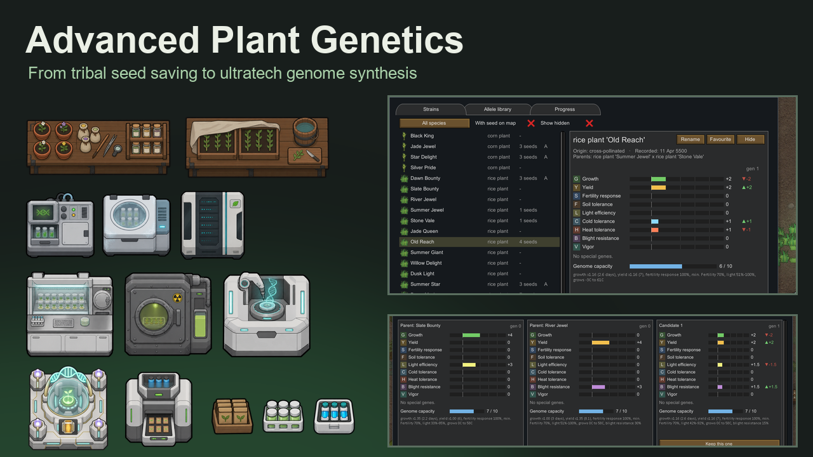

# Advanced Plant Genetics

A RimWorld 1.6 mod that turns plant genetics into a full progression path, from tribal seed saving to ultratech genome synthesis.



Every sown plant has a readable genome. You discover good plants, breed and engineer them, and reproduce the best as named strains. Better genetics need research, buildings, power, materials and skilled colonists, not just waiting.

Design notes: [DESIGN.md](DESIGN.md).

## Features

### The genome
- **Nine loci**, two alleles each, dominant or recessive: growth (G), yield (Y), fertility response (S), soil tolerance (F), light efficiency (L), cold tolerance (C), heat tolerance (H), blight resistance (B), vigor (V).
- **Special genes** (0-2 copies): perennial, frost-hardy, polyploid, bioluminescent, pollution-tolerant, circadian override, gene compression, runners, toxin scrubber, synthetic chromosome, chemosynthetic, deathless, and three phytomining genes (steel, silver, gold).
- **Mendelian inheritance.** Purebred lines breed true, hybrids segregate, recessive traits hide in carriers.
- **Genome capacity.** Improvements cost capacity, most negative levels refund it, and overloading costs growth and yield. You can't max everything, so you specialise: a hydroponic supercrop and a tundra crop are different designs.
- **Fertility response** is its own trait. High response pays off on rich soil and hydroponics (fertility 2.8) and hurts on poor soil; low response grows steadily everywhere. Minimum fertility is a separate locus.

### Progression

| Era | Research | Buildings | What you can do |
|---|---|---|---|
| Tribal | Seed saving | - | Collect seed from your best plants (they cross with their neighbours), sow strains, save seed at harvest |
| Medieval | Plant breeding, propagation | Crossing bench, propagation bench | Cross or self-pollinate and keep the best of several offspring; multiply strains true to type |
| Industrial | Genetic analysis, tissue culture, mutagenesis | Genetic analyzer, gene bank, tissue culture lab, mutagen chamber | Read hidden genotypes, archive strains, 1 packet to 12, induced mutations up to +6, polyploidy |
| Spacer | Gene splicing, seed synthesis, synthetic traits | Gene splicer, bioinformatics core, seed synthesizer | Edit loci from your allele library (up to +8), splice genes across species, automatic seed printing |
| Ultratech | Genome synthesis, phytomining | Genesis synthesizer | Alleles up to +10, synthetic chromosomes, plants that need no light, never die or mine metal |

What you can read grows with research: tribal colonists describe plants in words, medieval ones measure them, industrial labs read full genotypes.

### Seeds without micromanagement
- Wild-type farming is unchanged: no seeds, plants get a natural random genome.
- Pick a **strain** in a growing zone's or planter's seed stock to sow it. Each sown plant uses one seed packet from anywhere on the map; nobody hauls seed to the field.
- **Save seed** at harvest keeps a purebred field self-sustaining. Off-type seed is discarded, so hybrids need propagation, like real F1 hybrids.
- Seed packets stack by strain, are worth more with better genetics, and are sold by bulk and exotic traders.

### Performance
Wild plants skip genetics entirely: no genome is generated or saved for them. Genetics apply to sown and engineered plants by swapping the plant's phenotype into its def around vanilla methods. Measured in game: about +0.1 µs per growth-rate call on wild plants and under 1 µs on engineered ones.

## Requirements

- RimWorld 1.6
- [Harmony](https://steamcommunity.com/workshop/filedetails/?id=2009463077)
- Optional: Biotech (pollution genes)
- Optional: Progression: Agriculture (unlocking a crop also gives heirloom seed; a seed packet of a locked crop can unlock it, tested with `--pa`)
- Works with modded crops: any sowable plant gets a genome.

Load order: Harmony → (Biotech, Progression: Agriculture) → this mod. Safe to add to an existing save.

## Compatibility

| Mod | Result |
|---|---|
| Progression: Agriculture | Integrated; heirloom seed and crop unlocks, tested in the harness (`--pa`) |
| Vanilla Expanded plants | Load-ordered after them (see `About/About.xml`) |

## Getting started

1. Sow a wild or tribal crop and harvest it with **Save seed** on to keep a purebred strain.
2. Research **plant breeding** and build a **crossing bench**. Cross your best two strains and keep the best of the offspring.
3. Research **propagation** to multiply a good strain true to type.
4. Research **genetic analysis** to read hidden alleles, then build a **gene bank** to archive strains.
5. Later, unlock the Spacer and Ultratech branches for the gene splicer, seed synthesizer and genesis synthesizer.

## Building from source

```bash
bash build.sh                       # builds 1.6/Assemblies/AdvancedPlantGenetics.dll
bash deploy.sh                      # builds and copies the mod into the game's Mods folder
python -I tools/gen_buildings.py    # regenerates the building defs from their table
```

Paths are set for this machine in `Source/AdvancedPlantGenetics/AdvancedPlantGenetics.csproj` (`RimWorldDir`); override with `-p:RimWorldDir=...`.

## Testing

`Tests/run-ingame-tests.sh` starts RimWorld in an isolated save-data folder with a minimal, muted mod list and runs the harness in `Tests/APGTest`:
- genome math, growth/yield/fertility effects on real plants;
- sowing strains with real jobs, collecting seed, harvest seed saving;
- the crossing bench with hauling and work jobs, every lab operation, the autonomous synthesizer;
- save/reload, a UI smoke pass with screenshots, and a performance check.

Results go to `apgtest_results.txt` in the data folder. Pass `--pa` to also load Progression: Agriculture.

## Support

If you use the mod, a ⭐ **Star** on this repository helps others find it, and **Watch → Releases** on GitHub notifies you of new versions. Bug reports and feature requests go in [Issues](https://github.com/IyedBecheikh/AdvancedPlantGenetics/issues).

## Credits

- Inspired by Rust, AgriCraft, Forestry and Gendustry; [Plant Genetics Continued](https://github.com/JamEstHamEst/PlantGenetics-Continued) as a starting reference.
- Art generated to match the Vanilla Expanded style, using Vanilla Genetics Expanded textures as style references.

## License

[MIT](LICENSE)
